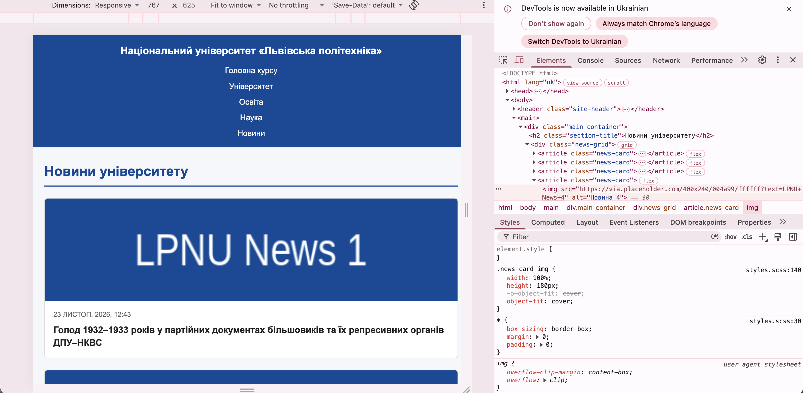
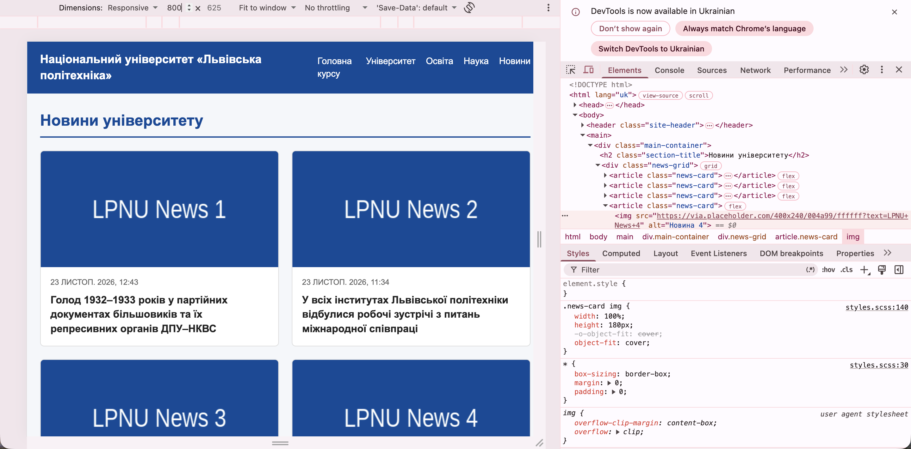
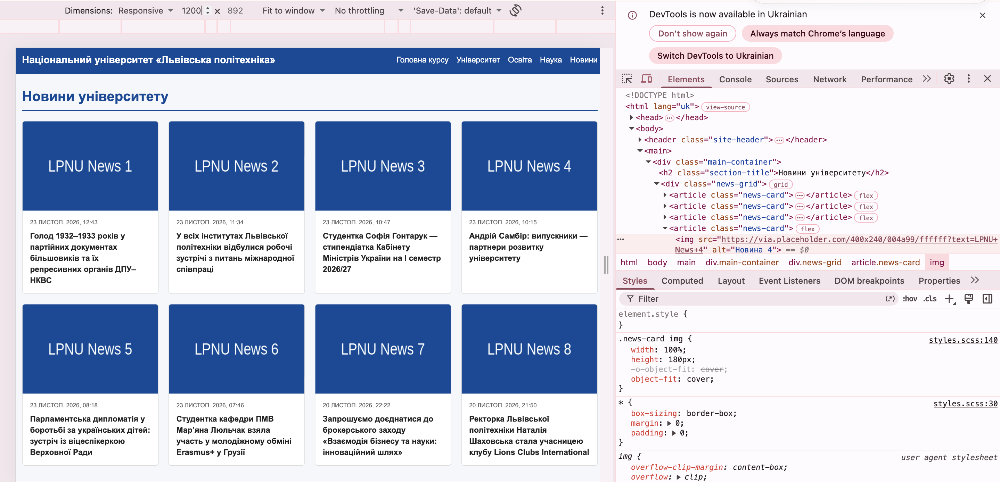

# Лабораторна робота №3
**Тема:** Верстка веб-сторінки з Grid та Responsive Breakpoints. Застосування SCSS.

---

## 1. Мета роботи
Закріпити навички створення адаптивної верстки веб-сторінок із використанням CSS Grid та медіа-запитів. На прикладі головної сторінки сайту lpnu.ua проаналізувати принципи реалізації адаптивного макету та відтворити фрагмент сторінки — блок новин, застосовуючи препроцесор SASS/SCSS.

---

## 2. Хід виконання роботи

1. Створено окрему гілку `lab3` у локальному Git-репозиторії та організовано структуру каталогів (`lab3/index.html`, `lab3/css/styles.css`, `lab3/scss/styles.scss`).
2. Проаналізовано структуру блоку «Новини університету» на офіційному сайті Національного університету «Львівська політехніка» (lpnu.ua) через інструмент розробника Chrome Developer Tools.
3. Зверстано HTML-сторінку з адаптивною шапкою (`header`) та блоком новин у контейнері `.main-container`.
4. Реалізовано сітку карток новин за допомогою модуля **CSS Grid Layout** з адаптацією під три діапазони екранів (Mobile, Tablet, Desktop).
5. Налаштовано компіляцію SCSS у CSS (`styles.css` та карти коду `styles.css.map`).
6. Виконано рефакторинг стилів у файлі `styles.scss`: винесено змінні кольорів та розмірів шрифтів, створено асоціативний масив (мапу) `$breakpoints` та міксин `@mixin respond-to($breakpoint)` для генерації медіа-запитів.
7. Додано посилання на лабораторну роботу №3 на головну сторінку курсу та виконано злиття гілки `lab3` з основною гілкою `main`.

---

## 3. Лістинг коду (SCSS)

Фрагмент файлу `lab3/scss/styles.scss` із використанням змінних, мапи брейкпоінтів, міксину та вкладеності:

```scss
// Змінні кольорів
$primary-color: #004a99;
$secondary-color: #f5f7fa;
$text-color: #222222;
$white-color: #ffffff;
$muted-color: #666666;
$border-color: #dddddd;

// Змінні розмірів шрифтів
$font-size-small: 12px;
$font-size-nav: 14px;
$font-size-base: 16px;
$font-size-logo: 18px;
$font-size-logo-desktop: 20px;
$font-size-heading: 24px;
$font-size-heading-desktop: 28px;

// Мапа брейкпоінтів та міксин
$breakpoints: (
  mobile: 576px,
  tablet: 768px,
  desktop: 1024px
);

@mixin respond-to($breakpoint) {
  @if map-has-key($breakpoints, $breakpoint) {
    @media (min-width: map-get($breakpoints, $breakpoint)) {
      @content;
    }
  }
}

.news-grid {
  display: grid;
  grid-template-columns: 1fr;
  gap: 20px;

  @include respond-to(tablet) {
    grid-template-columns: repeat(2, 1fr);
  }

  @include respond-to(desktop) {
    grid-template-columns: repeat(4, 1fr);
  }
}
```

---

## 4. Результати роботи (Скріншоти адаптивності)

### Мобільна версія (Mobile: до 767px — 1 колонка)


### Планшетна версія (Tablet: 768px – 1023px — 2 колонки)


### Десктопна версія (Desktop: від 1024px — 4 колонки)


---

## 5. Відповіді на питання вихідного контролю

### 1. Яким чином реалізовано сітку новин на сторінці lpnu.ua? Чим відрізняється від Вашої реалізації?
На офіційному сайті `lpnu.ua` сітка новин побудована на базі CSS-фреймворку Bootstrap з використанням одновимірної моделі **Flexbox** (контейнери `.row` та колонки `.col-*`). У нашій реалізації використано нативну двовимірну систему **CSS Grid Layout** (`display: grid` та `grid-template-columns`), що дозволяє зручно керувати рядками та колонками без додаткових обгорток у HTML-розмітці.

### 2. Які брекпоінти екрану додали на сторінці?
Додано 3 основні діапазони (брейкпоінти) для адаптації сітки новин та шапки сайту:
* **Mobile** (до `767px`, базовий поріг у мапі `576px`) — 1 колонка новин, вертикальне меню в шапці;
* **Tablet** (від `768px` до `1023px`) — 2 колонки новин, горизонтальне навігаційне меню;
* **Desktop** (від `1024px` і більше) — 4 колонки новин, збільшені розміри заголовків.

### 3. Які властивості CSS модуля Grid Layout використали в роботі?
У роботі використано такі властивості CSS Grid Layout:
* `display: grid` — для оголошення елемента `.news-grid` grid-контейнером;
* `grid-template-columns` із функцією `repeat()` та гнучкими одиницями `fr` — для визначення кількості та рівномірної ширини колонок на різних розширеннях екрана (`1fr`, `repeat(2, 1fr)`, `repeat(4, 1fr)`);
* `gap` — для задання однакових відступів між рядками та стовпцями сітки (`20px`).

### 4. Що таке SCSS і чим він відрізняється від CSS?
**SCSS** (Sassy CSS) — це основний синтаксис препроцесора **Sass**, який є розширенням стандартного CSS. На відміну від звичайного CSS, SCSS підтримує змінні, вкладеність селекторів, міксини (домішки), асоціативні масиви (мапи), умовні конструкції (`@if`), цикли та модульність (`@use`), але перед виконанням у браузері потребує компіляції у звичайний `.css` файл.

### 5. Як оголошуються змінні в SCSS? Наведіть приклад з роботи.
Змінні в SCSS оголошуються за допомогою символу `$` перед назвою змінної, після чого через двокрапку вказується її значення.  
**Приклад з роботи:**
```scss
$primary-color: #004a99;
$font-size-base: 16px;
```

### 6. Як використовуються міксини в SCSS? Наведіть приклад з роботи.
Міксини (домішки) оголошуються за допомогою директиви `@mixin назва($параметр)` для повторного використання груп CSS-правил, а підключаються у потрібному селекторі через директиву `@include назва(аргумент)`.  
**Приклад з роботи:**
```scss
@mixin respond-to($breakpoint) {
  @if map-has-key($breakpoints, $breakpoint) {
    @media (min-width: map-get($breakpoints, $breakpoint)) {
      @content;
    }
  }
}

.news-grid {
  @include respond-to(desktop) {
    grid-template-columns: repeat(4, 1fr);
  }
}
```

---

## 6. Висновок
Під час виконання лабораторної роботи №3 було опановано принципи адаптивної веб-верстки з використанням **CSS Grid Layout** та медіа-запитів для різних типів пристроїв (Mobile, Tablet, Desktop). Застосування препроцесора **SCSS** (змінних, вкладеності, мап та міксинів) дозволило зробити код стилів більш структурованим, читабельним і зручним для подальшої підтримки.
